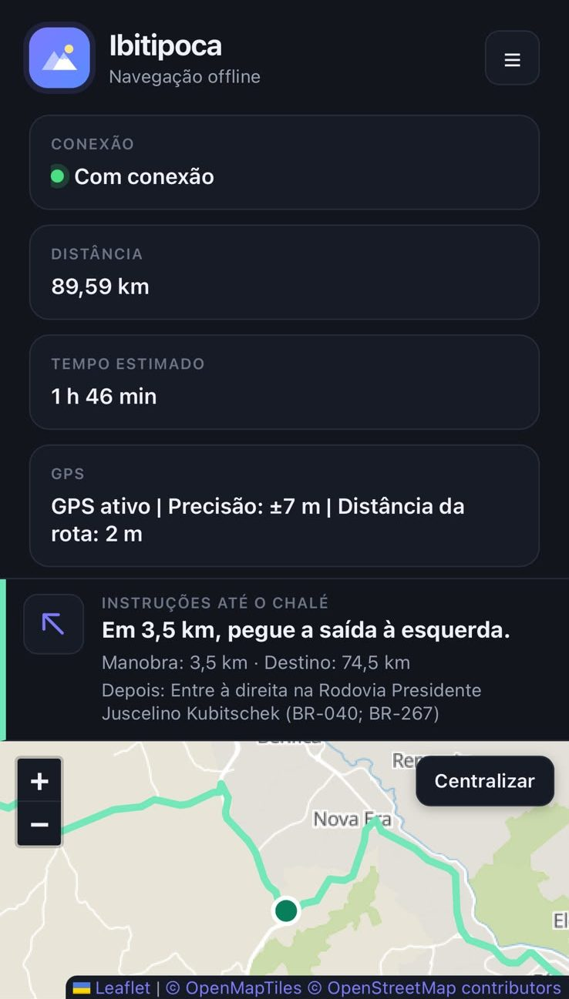
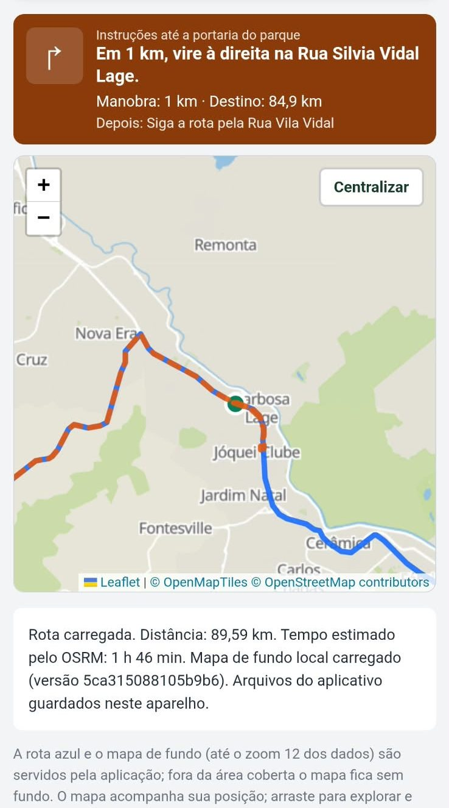
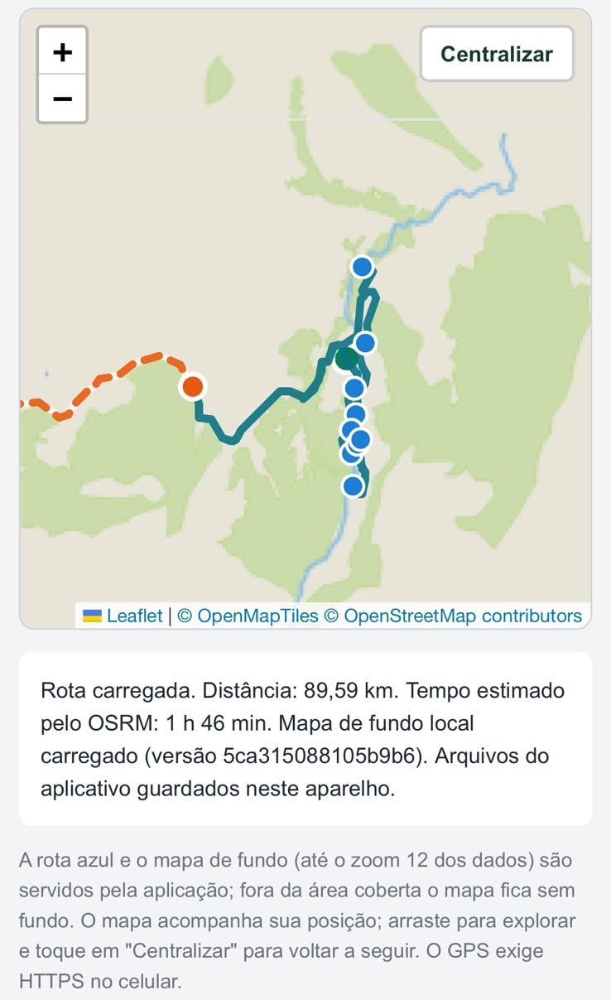

# OffGrid — navegação que funciona sem sinal

Aplicação web de navegação por GPS que continua guiando quando a internet acaba. Você escolhe o destino, a rota é calculada a partir da sua posição atual e fica guardada no aparelho: daí em diante, o mapa, a posição e as instruções passo a passo funcionam mesmo sem sinal.

> O projeto nasceu como **Projeto Ibitipoca**, para uma viagem de Juiz de Fora ao Parque Estadual do Ibitipoca (MG): ~90 km por estradas do interior, onde o sinal de celular não é garantido. A primeira versão guiou o trajeto inteiro funcionando offline, sem depender de apps comerciais nem de internet móvel.

## A primeira versão na estrada

<p align="center">
  
  
  
</p>

Da esquerda para a direita: navegação na rodovia com instruções em tempo real; a rota principal e a rota até a portaria do parque calculada na hora; e a trilha do Circuito das Águas dentro do parque. Essas telas são da V1, com trajetos fixos; a versão atual é genérica (veja abaixo).

## O que o app faz hoje

- **Destino livre na região Sudeste**: busca por nome (cidade, endereço, lugar) ou toque no mapa.
- **Rota a partir da posição atual**, calculada por um servidor [OSRM](https://project-osrm.org/) próprio.
- **Instruções passo a passo** em português, com distância até a próxima manobra e até o destino.
- **Alerta de desvio** quando você se afasta da rota de forma persistente, sem disparar com a oscilação normal do GPS.
- **Funcionamento offline**: o app, a última rota calculada e o mapa de fundo ficam guardados no aparelho (Service Worker + Cache API).
- **Download do mapa** com progresso, retomada e verificação de integridade de cada arquivo.
- **Simulação** do percurso, para testar sem sair de casa.

A rota precisa ser **calculada com internet**; depois disso, a navegação funciona sem sinal.

## Arquitetura

```
 Celular (navegador / PWA)                       Servidor (Oracle Cloud)
 ┌──────────────────────────────┐                ┌──────────────────────────────┐
 │ Leaflet: mapa e camadas      │                │ Caddy: HTTPS (Let's Encrypt) │
 │ navegacao.js: GPS e desvio   │    HTTPS       │   ├─ /osrm/route/v1/* → OSRM │
 │ instrucoes.js: passo a passo │ ◄────────────► │   └─ /* → ServidorWeb (Java) │
 │ rota-destino.js / busca      │                │                              │
 │ Service Worker: offline      │                │ ServidorWeb (Java 25)        │
 └──────────────────────────────┘                │   ├─ arquivos e tiles        │
                                                 │   ├─ /osrm (uso local)       │
                                                 │   └─ /api/buscar → Nominatim │
                                                 │ OSRM (Docker): rotas         │
                                                 └──────────────────────────────┘
```

- **Backend em Java 25 puro** (`com.sun.net.httpserver`, sem framework), com uma thread virtual por requisição.
- **Busca de destinos** pelo [Nominatim](https://nominatim.org/) do OpenStreetMap, sempre passando pelo servidor para cumprir a [política de uso](https://operations.osmfoundation.org/policies/nominatim/): no máximo 1 requisição por segundo para o app inteiro, identificação do app e cache.
- **Rotas** pelo OSRM com o extrato da região Sudeste da [Geofabrik](https://download.geofabrik.de/), perfil carro, algoritmo MLD.
- **Mapa de fundo** em tiles PNG gerados localmente a partir de [OpenMapTiles](https://openmaptiles.org/) e servidos pela própria aplicação.

## Tecnologias

| Camada | Ferramentas |
|---|---|
| Backend | Java 25, Maven, `HttpServer` do JDK, `HttpClient` |
| Front | JavaScript (sem framework), HTML, CSS, Leaflet 1.9.4 |
| Offline | Service Worker, Cache API, Geolocation API |
| Rotas e dados | OSRM, OpenStreetMap, Nominatim, OpenMapTiles |
| Infra | Oracle Cloud Always Free, Ubuntu, Docker, Caddy, systemd |
| Qualidade | `node:test` (testes automatizados), GitHub Actions |

## Rodando localmente

Pré-requisitos: Java 25, Maven, Node.js 20+ e Docker.

**1. OSRM com os dados da região** (uma vez; o processamento usa ~9 GB de RAM):

```bash
mkdir osrm-sudeste && cd osrm-sudeste
curl -L -o sudeste-latest.osm.pbf https://download.geofabrik.de/south-america/brazil/sudeste-latest.osm.pbf
docker run --rm -t -v "$PWD:/data" osrm/osrm-backend osrm-extract -p /opt/car.lua /data/sudeste-latest.osm.pbf
docker run --rm -t -v "$PWD:/data" osrm/osrm-backend osrm-partition /data/sudeste-latest.osrm
docker run --rm -t -v "$PWD:/data" osrm/osrm-backend osrm-customize /data/sudeste-latest.osrm
docker run -d --name osrm_local -p 5000:5000 -v "$PWD:/data" osrm/osrm-backend \
  osrm-routed --algorithm mld /data/sudeste-latest.osrm
```

**2. Aplicação:**

```bash
mvn -B clean package
java -cp target/classes ServidorWeb
```

Abra `http://localhost:8080/`. Variáveis de ambiente opcionais: `PORT` (padrão 8080), `OSRM_URL` (padrão `http://localhost:5000`) e `NOMINATIM_URL`.

**Simulando o GPS no computador:** no Chrome, DevTools → `⋮` → *More tools* → **Sensors** → *Location*. Crie uma localização com **precisão (accuracy) de até 100 m**: o app recusa posições imprecisas para não traçar rota a partir do lugar errado.

## Testes

```bash
node --test src/test/js/
```

São cerca de 150 testes cobrindo GPS e detecção de desvio, instruções, cálculo de rota, busca, download offline, Service Worker e o servidor Java (com OSRM e Nominatim simulados). Os testes do servidor rodam depois de `mvn package`. A rota real da viagem (89,6 km, 2.418 coordenadas) é usada como dado de teste.

## Próximos passos

- [ ] OSRM da região Sudeste em produção
- [ ] Mapa vetorial (PMTiles + MapLibre) para toda a região
- [ ] Download offline só do corredor da rota escolhida
- [ ] Trilhas próximas à localização atual
- [ ] Nova identidade visual (OffGrid)

## Créditos

- Interface: [guilhermetavarees](https://github.com/guilhermetavarees).
- Dados do mapa © colaboradores do [OpenStreetMap](https://www.openstreetmap.org/copyright), disponíveis sob a licença ODbL.
- Estilo e tiles: © [OpenMapTiles](https://openmaptiles.org/).
- Rotas: [OSRM](https://project-osrm.org/). Busca: [Nominatim](https://nominatim.org/). Mapa: [Leaflet](https://leafletjs.com/).
